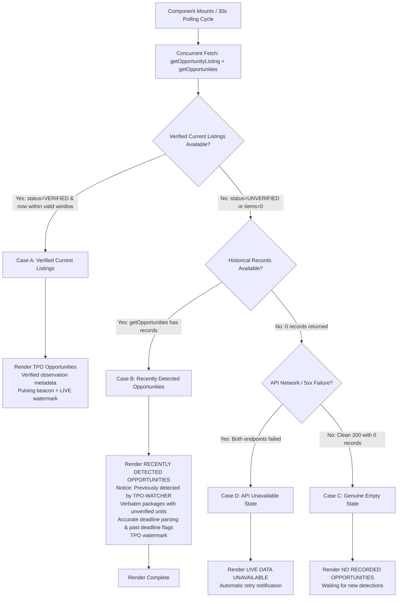

# TPO-WATCHER — HOMEPAGE OPPORTUNITY VISIBILITY FIX SPECIFICATION

**Date:** 23 October 2026  
**Implementation Scope:** Frontend Integration Fallback & Data Contract Isolation  
**Target Release:** Scoped Remediation Release  
**Status:** Implemented, Tested, and Verified Locally  

---

## 1. Architectural Strategy & Design Rules

To resolve the discrepancy between the hero opportunities panel and the Intelligence Archive without breaking verified-listing rigor, a resilient four-case visibility architecture was implemented:



---

## 2. Strict Evidence & Honesty Invariants Enforced

1. **No Manufactured Freshness:** When verified current listings are absent, the application never synthesizes observation timestamps or sets `listing_status = 'CURRENT'`.
2. **Explicit Historical Labeling:** Historical fallback records are presented under the exact header `RECENTLY DETECTED OPPORTUNITIES` with an amber status beacon and the prominent banner:
   ```text
   Previously detected by TPO-WATCHER — current availability not verified
   ```
3. **No Inference of Open Registration:** `is_active = 'True'` from legacy database records is never presented as proof that registration is open.
4. **Accurate Deadline Presentation:** Registration deadlines are displayed verbatim from the database. Deadlines that have elapsed (e.g. `21-Oct-2026`) are explicitly tagged as `(Passed)`. If unrecorded, the card displays `Not reported in source`.
5. **Verbatim Compensation Values:** Historical compensation values are labeled `(unit unverified)` rather than asserting `LPA`.
6. **No Mock Companies:** No synthetic company names (Google, Microsoft, Goldman Sachs) or hardcoded IDs exist in code or bundled output.

---

## 3. Exact File Modifications

### 3.1 `frontend/src/lib/api.ts`
- **Separated Data Contracts:** Defined `LegacyOpportunity` (10 fields from `/api/v1/opportunities`) distinctly from `VerifiedOpportunity` (rich fields from `/api/v1/opportunity-listing`).
- **Validation:** Added `isLegacyOpportunityArray` validator to guarantee payload integrity before returning data to components.
- **Backwards Compatibility:** Exported `Opportunity = VerifiedOpportunity` alias.

```typescript
// Legacy / Historical opportunity record from /api/v1/opportunities
export interface LegacyOpportunity {
  id: string
  company: string
  max_package: string | null
  min_package: string | null
  placement_type: string | null
  registration_end: string | null
  eligible_programs: string | null
  company_type: string | null
  is_active: string | null
  first_seen_at: string | null
}

// Verified opportunity record from /api/v1/opportunity-listing
export interface VerifiedOpportunity {
  id: string
  company: string
  max_package: string | null
  min_package: string | null
  placement_type: string | null
  registration_end: string | null
  eligible_programs: string | null
  company_type: string | null
  is_active: string | null
  first_seen_at: string | null
  registration_start: string | null
  registration_start_time: string | null
  registration_end_time: string | null
  registration_start_alternate: string | null
  registration_end_alternate: string | null
  deadline_timezone: string | null
  compensation_unit: string | null
  organizations: string | null
  job_title: string | null
  job_description: string | null
  academic_year: string | null
  eligibility_status: 'PROGRAMME_MATCH_ONLY'
  listing_status: 'CURRENT'
  observed_ms: number
  valid_until_ms: number
}
```

### 3.2 `frontend/src/components/sections/LiveOpportunities.tsx`
- **Concurrent Polling:** Concurrently queries `api.getOpportunityListing()` and `api.getOpportunities()`.
- **Four-Case Rendering:** Renders Case A when verified items exist; Case B when only historical records exist; Case C when both are genuinely empty; Case D when network/API fails.
- **Deadline Evaluator:** Implemented `parseDeadline` to accurately evaluate whether registration dates have passed relative to `now`.
- **Watermark Tuning:** Renders `LIVE` only when verified current listings are present; renders `TPO` for historical and empty states.
- **Linter & Purity Fix:** Initialized `now` state using lazy initializer `useState(() => Date.now())` to ensure zero purity warnings.

### 3.3 `frontend/src/components/sections/RecentDetections.tsx`
- Explicitly typed state and props with `LegacyOpportunity[]` matching the exact schema returned by `/api/v1/opportunities`.

---

## 4. Production Bundle Integrity

The frontend bundle was built via `npm run build` (`tsc -b && vite build`):

| Bundle Chunk | Size | Gzip Size | Role |
|---|---|---|---|
| `app/static/index.html` | 1.66 kB | 0.70 kB | SPA entry document |
| `app/static/assets/index-DQ_HPArr.js` | 121.89 kB | 29.74 kB | Main application code |
| `app/static/assets/index-DiOMdZHI.css` | 32.34 kB | 7.06 kB | Stylesheet & Tailwind styles |
| `app/static/assets/vendor-B6_ti3ZI.js` | 210.61 kB | 65.68 kB | React 19 & vendor dependencies |
| `app/static/assets/motion-IBPrb1m6.js` | 127.87 kB | 41.77 kB | Framer Motion animation engine |
| `app/static/assets/icons-gk8odPvC.js` | 16.96 kB | 6.63 kB | Lucide icons chunk |
| `app/static/assets/rolldown-runtime-CbXtAM7H.js` | 0.58 kB | 0.36 kB | Vite ESM runtime |

*Zero-Downtime Cache Safety:* Pre-existing release assets were preserved in `app/static/assets/` to ensure zero 404 errors for clients holding cached HTML during deployment.
